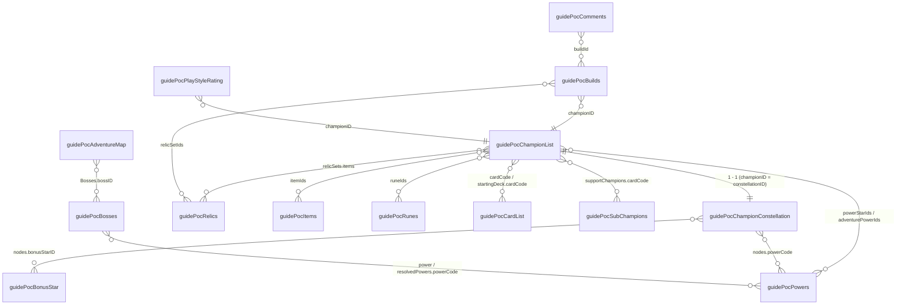

# TÀI LIỆU CẤU TRÚC CƠ SỞ DỮ LIỆU (DATABASE SCHEMA SPECIFICATION)
> **Dự án:** The Path of Champions Guide (LoR PoC)  
> **Thư mục dữ liệu:** `be/uploadData/backup_rework_full_archive/`  
> **Thời điểm xuất:** Ngày 10 Tháng 11 Năm 2026  
> **Mục đích:** Tài liệu chuẩn hóa cấu trúc toàn bộ 17 Collections phục vụ công tác Rework toàn diện Frontend & Backend.

---

## 1. TỔNG QUAN HỆ THỐNG DỮ LIỆU

Cơ sở dữ liệu được xây dựng trên **MongoDB Atlas**, gồm **17 collections** phục vụ từ dữ liệu tĩnh (tướng, thẻ bài, sức mạnh, cổ vật) đến dữ liệu động do người dùng tạo (bài đăng, bình luận, đánh giá, nhật ký kiểm toán).

### Bảng tóm tắt các Collections

| STT | Tên Collection | File JSON | Khóa chính | Số bản ghi | Chức năng chính |
| :---: | :--- | :--- | :--- | :---: | :--- |
| 1 | `guidePocChampionList` | `guidePocChampionList.json` | `championID` | 89 | Danh sách & thông tin chuyên sâu của từng vị tướng |
| 2 | `guidePocChampionConstellation` | `guidePocChampionConstellation.json` | `constellationID` | 89 | Cây chòm sao (Constellation Nodes) của từng tướng |
| 3 | `guidePocPowers` | `guidePocPowers.json` | `powerCode` | 1,196 | Kho sức mạnh (Star Powers, Foe Powers, General) |
| 4 | `guidePocRelics` | `guidePocRelics.json` | `relicCode` | 155 | Kho cổ vật (Relics thường, hiếm, sử thi) |
| 5 | `guidePocItems` | `guidePocItems.json` | `itemCode` | 187 | Kho trang bị gắn vào thẻ bài (Card Items) |
| 6 | `guidePocRunes` | `guidePocRunes.json` | `runeCode` | 32 | Kho ngọc bổ trợ theo khu vực (Runes) |
| 7 | `guidePocBonusStar` | `guidePocBonusStar.json` | `bonusStarID` | 341 | Các node sao bổ trợ chỉ số (Bonus Stars) |
| 8 | `guidePocCardList` | `guidePocCardList.json` | `cardCode` | 2,686 | Toàn bộ thẻ bài LoR / PoC (Units, Spells, Landmarks) |
| 9 | `guidePocSubChampions` | `guidePocSubChampions.json` | `cardCode` | 126 | Gói viện trợ tướng phụ (Support Champion Packs) |
| 10 | `guidePocBosses` | `guidePocBosses.json` | `bossID` | 338 | Danh sách trùm / kẻ địch trong các cuộc phiêu lưu |
| 11 | `guidePocAdventureMap` | `guidePocAdventureMap.json` | `adventureID` | 48 | Bản đồ phiêu lưu (Adventures & Weekly Nightmares) |
| 12 | `guidePocBuilds` | `guidePocBuilds.json` | `id` | 103 | Bản dựng (Builds) do cộng đồng hoặc ban quản trị tạo |
| 13 | `guidePocFavoriteBuilds` | `guidePocFavoriteBuilds.json` | `id` | 42 | Danh sách build được người dùng lưu vào yêu thích |
| 14 | `guidePocPlayStyleRating` | `guidePocPlayStyleRating.json` | `championID` + `userSub` | 21 | Đánh giá phong cách chơi & điểm số từ cộng đồng |
| 15 | `guidePocComments` | `guidePocComments.json` | `id` | 31 | Bình luận và thảo luận của người dùng |
| 16 | `guidePocAuditLogs` | `guidePocAuditLogs.json` | `logId` | 1,181 | Lịch sử chỉnh sửa, kiểm toán dữ liệu từ Admin CMS |
| 17 | `guidePocGuideList` | `guidePocGuideList.json` | `slug` | 0 | Bảng bài viết hướng dẫn dài (Dự phòng mở rộng) |

---

## 2. SƠ ĐỒ MỐI QUAN HỆ THỰC THỂ (ERD)



---

## 3. CHI TIẾT CẤU TRÚC TỪNG BỘ DỮ LIỆU

### 3.1. `guidePocChampionList` (Dữ liệu chi tiết Tướng)
- **File:** `guidePocChampionList.json`
- **Khóa chính:** `championID` (Ví dụ: `C001`, `C088`)
- **Số bản ghi:** 89

#### Danh sách trường:
| Trường | Kiểu dữ liệu | Bắt buộc | Mô tả |
| :--- | :--- | :---: | :--- |
| `championID` | `String` | Có | Mã định danh duy nhất của tướng (Format: `Cxxx`) |
| `name` | `String` | Có | Tên tiếng Việt của tướng (Ví dụ: "Heimerdinger", "Xerath") |
| `cardCode` | `String` | Có | Mã lá bài tướng gốc trong LoR (Ví dụ: `01PZ056`, `05SH014`) |
| `cost` | `Number` | Có | Năng lượng tiêu hao gốc để triển khai tướng |
| `regions` | `Array<String>` | Có | Danh sách khu vực (Ví dụ: `["Piltover & Zaun"]`) |
| `maxStar` | `Number` | Có | Cấp sao tối đa hiện có của tướng (Thường là `3` hoặc `6`) |
| `assets` | `Array<Object>` | Có | Mảng chứa đường dẫn ảnh: `{ gameAbsolutePath, fullAbsolutePath, avatar }` |
| `description` | `String` | Có | Hướng dẫn tổng quan lối chơi đã bọc thẻ Markup |
| `descriptionRaw` | `String` | Có | Hướng dẫn tổng quan dạng văn bản thô (Plain Text) |
| `startingDeck` | `Array<Object>` | Có | Bộ bài khởi đầu: `[{ cardCode, count, items: [] }]` |
| `powerStarIds` | `Array<String>` | Có | Danh sách `powerCode` của các sao sức mạnh (1★ đến 6★) |
| `itemIds` | `Array<String>` | Có | Danh sách `itemCode` vật phẩm khuyên dùng ưu tiên |
| `adventurePowerIds` | `Array<String>` | Có | Danh sách `powerCode` sức mạnh phiêu lưu khuyên dùng |
| `runeIds` | `Array<String>` | Có | Danh sách `runeCode` ngọc khuyên dùng |
| `relicSets` | `Array<Object>` | Có | Các bộ cổ vật đề xuất (Chi tiết bên dưới) |
| `supportChampions` | `Array<Object>` | Không | Gói tướng phụ khuyên dùng: `[{ cardCode, name }]` |
| `comboSteps` | `Array<Object>` | Không | Các bước combo đề xuất: `[{ title, desc }]` |
| `proTips` | `Array<String>` | Không | Mẹo chơi nâng cao từ cao thủ |
| `playStyle` | `Array<String>` | Không | Thẻ định hình phong cách: `["Aggro", "Control", "Combo"]` |
| `powerSpike` | `String` | Không | Ngưỡng sức mạnh đột biến (Ví dụ: "2★", "3★", "6★") |
| `counter` | `String` | Không | Kẻ địch hoặc yếu tố khắc chế |
| `optimalStars` | `String` | Không | Mốc sao chơi mượt nhất (Ví dụ: "3★") |
| `tier` | `String` | Không | Xếp hạng sức mạnh tổng quan (`S+`, `S`, `A`, `B`) |
| `tags` | `Array<String>` | Không | Các tag phân loại: `["NEW 6★", "SHURIMA", "TƯỚNG MỚI"]` |
| `videoLink` | `String` | Không | Link video YouTube hướng dẫn lối chơi |
| `translations` | `Object` | Có | Bản dịch tiếng Anh: `{ en: { name, description, descriptionRaw, relicSets, ... } }` |
| `communityRatings` | `Object` | Không | Điểm số tổng hợp từ cộng đồng |
| `ratings` | `Object` | Không | Chỉ số radar chart: `{ offensive, defensive, combo, speed, difficulty }` |

#### Cấu trúc một phần tử trong `relicSets`:
```json
{
  "title": "Bộ 1 // Hóa Kỹ Thiên Thạch",
  "recommendedStars": 5,
  "items": ["R0048", "R0046", "R0118"],
  "buildType": "Tiêu Chuẩn",
  "difficultyRating": "Trung Bình",
  "description": "Nội dung phân tích lối chơi có chứa markup [r:R0118|Tên]...",
  "descriptionRaw": "Nội dung phân tích thô...",
  "translations": {
    "en": {
      "title": "Set 1 // Chemtech Meteor",
      "description": "English description with markup...",
      "descriptionRaw": "English plain text..."
    }
  }
}
```

---

### 3.2. `guidePocChampionConstellation` (Cây Chòm Sao)
- **File:** `guidePocChampionConstellation.json`
- **Khóa chính:** `constellationID` (Trùng với `championID`, ví dụ: `C001`)
- **Số bản ghi:** 89

#### Danh sách trường:
| Trường | Kiểu dữ liệu | Mô tả |
| :--- | :--- | :--- |
| `constellationID` | `String` | Mã định danh chòm sao (Khớp 1:1 với `championID`) |
| `championName` | `String` | Tên tướng sở hữu chòm sao |
| `backgroundImage` | `String` | Link ảnh nền art toàn cảnh của chòm sao |
| `nodes` | `Array<Object>` | Danh sách toàn bộ các node trên bản đồ chòm sao |

#### Cấu trúc một node trong `nodes`:
```json
{
  "nodeID": "n1",
  "nodeType": "starPower",          // "starPower" (Sức mạnh sao) hoặc "bonusStar" (Chỉ số)
  "powerCode": "P0443",             // Tồn tại nếu nodeType === "starPower"
  "bonusStarID": null,              // Tồn tại nếu nodeType === "bonusStar" (VD: "C0001")
  "position": { "x": 69.9, "y": 13.8 }, // Tọa độ phần trăm (%) trên canvas chòm sao
  "isRecommended": true,            // Gợi ý ưu tiên nâng cấp
  "nextNodes": ["n2"],              // Danh sách nodeID kế tiếp được mở khóa
  "requirements": [                 // Nguyên liệu mở khóa
    { "type": "Fragment", "value": 10 }
  ]
}
```

---

### 3.3. `guidePocPowers` (Kho Sức Mạnh)
- **File:** `guidePocPowers.json`
- **Khóa chính:** `powerCode` (Ví dụ: `P0001`, `P0443`, `FP0001`)
- **Số bản ghi:** 1,196

#### Danh sách trường:
| Trường | Kiểu dữ liệu | Quy ước giá trị | Mô tả |
| :--- | :--- | :--- | :--- |
| `powerCode` | `String` | `Pxxxx` (Người chơi) hoặc `FPxxxx` (Kẻ địch) | Mã sức mạnh |
| `name` | `String` | Tên tiếng Việt | Tên sức mạnh |
| `type` | `String` | `"Star Power"` \| `"General Power"` \| `"Foe Power"` | Phân loại nguồn gốc sức mạnh |
| `rarity` | `String` | Chữ thường: `"common"`, `"rare"`, `"epic"`, `"legendary"` | Độ hiếm |
| `description` | `String` | Văn bản đã bọc thẻ Markup `[k:Keyword|Từ khóa]` | Mô tả hiển thị |
| `descriptionRaw` | `String` | Plain Text | Mô tả nguyên bản |
| `assetAbsolutePath` | `String` | URL ảnh icon (`https://dd.b.pvp.net/...`) | Ảnh biểu tượng |
| `assetFullAbsolutePath` | `String` | URL ảnh phân giải cao | Ảnh chất lượng cao |
| `translations` | `Object` | `{ en: { name, description, descriptionRaw, rarity } }` | Bản dịch tiếng Anh |

---

### 3.4. `guidePocRelics` (Kho Cổ Vật)
- **File:** `guidePocRelics.json`
- **Khóa chính:** `relicCode` (Ví dụ: `R0001`, `R0189`)
- **Số bản ghi:** 155

#### Danh sách trường:
| Trường | Kiểu dữ liệu | Quy ước giá trị | Mô tả |
| :--- | :--- | :--- | :--- |
| `relicCode` | `String` | `Rxxxx` | Mã cổ vật |
| `name` | `String` | Tên tiếng Việt | Tên cổ vật |
| `type` | `Array<String>` | `["Chung"]` hoặc `["Trấn"]` | Phân loại cổ vật dùng chung hay độc quyền |
| `rarity` | `String` | Viết hoa: `"THƯỜNG"`, `"HIẾM"`, `"SỬ THI"` | Độ hiếm cổ vật |
| `stack` | `String` | `"1"`, `"2"`, `"3"` | Số lượng có thể cộng dồn tối đa |
| `description` | `String` | Markup text | Hiệu ứng của cổ vật |
| `descriptionRaw` | `String` | Plain text | Hiệu ứng thô |
| `image` | `String` | Link ảnh WebP tĩnh trên CDN | Ảnh tối ưu giao diện |
| `assetAbsolutePath` | `String` | URL Data Dragon Riot | Ảnh nguyên bản từ Riot |
| `assetFullAbsolutePath` | `String` | URL Data Dragon Full | Ảnh chất lượng cao |
| `source` | `String` \| `null` | Nguồn mở khóa (Quest, Empyrean, Bundle...) | Nơi nhận cổ vật |
| `translations` | `Object` | `{ en: { name, description, descriptionRaw, rarity } }` | Bản dịch tiếng Anh |

---

### 3.5. `guidePocItems` (Vật Phẩm Gắn Thẻ Bài)
- **File:** `guidePocItems.json`
- **Khóa chính:** `itemCode` (Ví dụ: `I0001`, `I0072`)
- **Số bản ghi:** 187

#### Danh sách trường:
| Trường | Kiểu dữ liệu | Quy ước giá trị | Mô tả |
| :--- | :--- | :--- | :--- |
| `itemCode` | `String` | `Ixxxx` | Mã vật phẩm |
| `name` | `String` | Tên tiếng Việt | Tên vật phẩm |
| `type` | `Array<String>` | `["Vật phẩm"]`, `["Spell Items"]`, `["Trang bị"]` | Loại thẻ có thể gắn |
| `rarity` | `String` | Title Case: `"Thường"`, `"Hiếm"`, `"Sử Thi"` | Độ hiếm |
| `requirements` | `String` | Điều kiện gắn trang bị (có markup) | Yêu cầu bài quân / bài phép |
| `requirementsRaw` | `String` | Điều kiện thô | Yêu cầu dạng thô |
| `description` | `String` | Markup text | Hiệu ứng tăng cường cho lá bài |
| `descriptionRaw` | `String` | Plain text | Hiệu ứng thô |
| `assetAbsolutePath` | `String` | URL Data Dragon | Ảnh biểu tượng |
| `assetFullAbsolutePath`| `String` | URL Data Dragon Full | Ảnh đầy đủ |
| `translations` | `Object` | `{ en: { name, description, descriptionRaw, rarity, requirements } }` | Bản dịch tiếng Anh |

---

### 3.6. `guidePocRunes` (Ngọc Bổ Trợ)
- **File:** `guidePocRunes.json`
- **Khóa chính:** `runeCode` (Ví dụ: `RN001`, `RN032`)
- **Số bản ghi:** 32

#### Danh sách trường:
| Trường | Kiểu dữ liệu | Mô tả |
| :--- | :--- | :--- |
| `runeCode` | `String` | Mã ngọc bổ trợ (Format: `RNxxx`) |
| `name` | `String` | Tên ngọc |
| `region` | `String` | Khu vực liên kết (Ví dụ: `"spiritblossom"`, `"shadowisles"`) |
| `rarity` | `String` | Độ hiếm (`"common"`, `"rare"`, `"epic"`) |
| `description` | `String` | Hiệu ứng ngọc (Markup) |
| `descriptionRaw` | `String` | Hiệu ứng thô (Plain text) |
| `assetAbsolutePath` | `String` | Link ảnh Data Dragon |
| `assetFullAbsolutePath` | `String` | Link ảnh Full Data Dragon |
| `translations` | `Object` | Bản dịch tiếng Anh `{ en: { name, description, region, ... } }` |

---

### 3.7. `guidePocBonusStar` (Sao Bổ Trợ)
- **File:** `guidePocBonusStar.json`
- **Khóa chính:** `bonusStarID` (Ví dụ: `C0001`, `BS001`)
- **Số bản ghi:** 341

#### Danh sách trường:
| Trường | Kiểu dữ liệu | Mô tả |
| :--- | :--- | :--- |
| `bonusStarID` | `String` | Mã node sao bổ trợ |
| `name` | `String` | Tên thuộc tính tăng cường (Ví dụ: "Ngôi Sao Tiền Thưởng") |
| `nodeType` | `String` | Luôn là `"bonusStar"` |
| `image` | `String` | Link ảnh icon ngôi sao |
| `description` | `String` | Chỉ số tăng (Ví dụ: `+10 Máu Nhà Chính, +4 Hồi Phục.`) |
| `descriptionRaw` | `String` | Chỉ số tăng dạng thô |
| `translations` | `Object` | Bản dịch tiếng Anh `{ en: { name, description, descriptionRaw } }` |

---

### 3.8. `guidePocCardList` (Kho Thẻ Bài Tổng Hợp)
- **File:** `guidePocCardList.json`
- **Khóa chính:** `cardCode` (Ví dụ: `01DE001`, `05SH014`, `98SH010`)
- **Số bản ghi:** 2,686

#### Danh sách trường:
| Trường | Kiểu dữ liệu | Quy ước giá trị | Mô tả |
| :--- | :--- | :--- | :--- |
| `cardCode` | `String` | Mã Riot LoR (Ví dụ: `01DE012`, `98SH010`) | Mã lá bài |
| `cardName` | `String` | Tên tiếng Việt | Tên lá bài |
| `cost` | `Number` | Số nguyên $\ge 0$ | Tiêu hao năng lượng |
| `type` | `String` | Viết thường: `"unit"`, `"spell"`, `"landmark"`, `"equipment"`, `"trap"` | Phân loại lá bài |
| `rarity` | `String` | Capitalized: `"Common"`, `"Rare"`, `"Epic"`, `"Champion"`, `"None"` | Độ hiếm lá bài |
| `regions` | `Array<String>` | Danh sách khu vực (Ví dụ: `["Shurima"]`) | Khu vực xuất xứ |
| `keywords` | `Array<String>` | Các từ khóa tiếng Việt (`["Đếm Ngược", "Siêu Tốc"]`) | Từ khóa thẻ bài |
| `subtypes` | `Array<String>` | Viết hoa (`["ELITE"]`, `["THỂ THĂNG HOA"]`) | Tộc / Hệ |
| `associatedCardRefs`| `Array<String>` | Mảng mã `cardCode` các lá liên kết | Lá bài liên đới/token sinh ra |
| `description` | `String` | Markup text | Hiệu ứng thẻ bài |
| `descriptionRaw` | `String` | Plain text | Hiệu ứng thô |
| `gameAbsolutePath` | `String` | URL HTTPS Data Dragon Riot | Link ảnh lá bài chuẩn |
| `translations` | `Object` | `{ en: { cardName, description, descriptionRaw, type, gameAbsolutePath, keywords, regions } }` | Bản dịch tiếng Anh |

---

### 3.9. `guidePocSubChampions` (Gói Tướng Phụ)
- **File:** `guidePocSubChampions.json`
- **Khóa chính:** `cardCode` (Ví dụ: `01DE012` - Garen)
- **Số bản ghi:** 126

#### Danh sách trường:
| Trường | Kiểu dữ liệu | Mô tả |
| :--- | :--- | :--- |
| `cardCode` | `String` | Mã lá bài của tướng phụ cầm đầu gói |
| `name` | `String` | Tên tướng phụ (Ví dụ: "Garen", "Lucian") |
| `packageName` | `String` | Tên gói viện trợ (Ví dụ: "Reinforcement of Garen") |
| `fullAbsolutePath` | `String` | Link ảnh splash art tướng phụ |
| `cards` | `Array<Object>` | Danh sách các lá đi kèm trong gói: `[{ cardCode, name, count, image }]` |
| `comfortableItems` | `Array<Object>` | Các vật phẩm tương thích tối ưu khi gắn vào gói bài này |

---

### 3.10. `guidePocBosses` (Trùm & Kẻ Địch)
- **File:** `guidePocBosses.json`
- **Khóa chính:** `bossID` (Ví dụ: `B001`, `B008`)
- **Số bản ghi:** 338

#### Danh sách trường:
| Trường | Kiểu dữ liệu | Mô tả |
| :--- | :--- | :--- |
| `bossID` | `String` | Mã định danh trùm (Format: `Bxxx`) |
| `bossName` | `String` | Tên kẻ địch (Ví dụ: "Poro Rạng Rỡ", "Aurelion Sol") |
| `background` | `String` | Ảnh nền màn hình chạm trán |
| `power` | `Array<String>` | Mảng chứa danh sách `powerCode` của trùm |
| `resolvedPowers` | `Array<Object>` | Chi tiết đã phân giải của các sức mạnh: `[{ powerCode, name, rarity, description }]` |
| `translations` | `Object` | `{ en: { bossName } }` |

---

### 3.11. `guidePocAdventureMap` (Bản Đồ Phiêu Lưu)
- **File:** `guidePocAdventureMap.json`
- **Khóa chính:** `adventureID` (Ví dụ: `A001`, `A048`)
- **Số bản ghi:** 48

#### Danh sách trường:
| Trường | Kiểu dữ liệu | Mô tả |
| :--- | :--- | :--- |
| `adventureID` | `String` | Mã định danh màn chơi |
| `adventureName` | `String` | Tên cuộc phiêu lưu (Ví dụ: "Thử Thách Aurelion Sol", "Cơn Ác Mộng 6.5★") |
| `difficulty` | `Number` \| `String` | Độ khó sao (Ví dụ: `1`, `4.5`, `6.5`) |
| `typeAdventure` | `String` | Loại bản đồ: `"World Adventure"`, `"Weekly Nightmare"`, `"Event"` |
| `championXP` | `Number` | Kinh nghiệm tướng nhận được khi hoàn thành |
| `background` | `String` | Ảnh nền bản đồ |
| `assetAbsolutePath` | `String` | Ảnh minh họa màn chơi |
| `Bosses` | `Array<Object>` | Các trùm xuất hiện trong màn: `[{ bossID, mapBonusPower, note }]` |
| `requirement` | `Object` \| `Array` | Yêu cầu khu vực/cấp sao để vào map |
| `rewards` | `Array<Object>` | Phần thưởng hoàn thành màn đấu |
| `specialRules` | `Array<String>` | Các luật thi đấu đặc biệt của map |
| `specialBlocks` | `Array<Object>` | Các khối sự kiện đặc biệt trên hành trình |
| `nodes` | `Array<Object>` | Cấu trúc phân nhánh các node trên bản đồ |
| `translations` | `Object` | Bản dịch tiếng Anh `{ en: { adventureName, ... } }` |

---

### 3.12. `guidePocBuilds` (Bản Dựng - Lối Lên Đồ)
- **File:** `guidePocBuilds.json`
- **Khóa chính:** `id` (UUIDv4)
- **Số bản ghi:** 103

#### Danh sách trường:
| Trường | Kiểu dữ liệu | Mô tả |
| :--- | :--- | :--- |
| `id` | `String` | UUID duy nhất của bản dựng |
| `championID` | `String` | Mã tướng áp dụng bản dựng (Liên kết `guidePocChampionList`) |
| `star` | `Number` | Mốc sao tối thiểu khuyến nghị cho build |
| `relicSetIds` | `Array<String>` | Danh sách mã cổ vật `relicCode` (Tối đa 3 cổ vật) |
| `powerIds` | `Array<String>` | Danh sách mã sức mạnh `powerCode` tương thích |
| `runeIds` | `Array<String>` | Danh sách mã ngọc `runeCode` đề xuất |
| `description` | `String` | Hướng dẫn chiến thuật & thứ tự vận hành |
| `creator` | `String` | Tên tác giả tạo build |
| `sub` | `String` | ID tài khoản người dùng tạo build |
| `regions` | `Array<String>` | Khu vực của tướng |
| `views` | `Number` | Lượt xem |
| `like` | `Number` | Lượt thích |
| `display` | `String` \| `Boolean` | Cờ cho phép hiển thị công khai trên thư viện (`"true"` / `true`) |
| `createdAt` | `String` (ISO 8601) | Thời điểm khởi tạo |

---

### 3.13. `guidePocFavoriteBuilds` (Build Yêu Thích Của Người Dùng)
- **File:** `guidePocFavoriteBuilds.json`
- **Khóa chính:** `id`
- **Số bản ghi:** 42

#### Danh sách trường:
| Trường | Kiểu dữ liệu | Mô tả |
| :--- | :--- | :--- |
| `id` | `String` | Mã build được yêu thích (Khớp với `guidePocBuilds.id`) |
| `user_sub` | `String` | ID tài khoản lưu yêu thích |
| `username` | `String` | Tên người dùng |
| `championName` | `String` | Tên tướng của build |
| `creatorName` | `String` | Tác giả tạo build gốc |
| `createdAt` | `String` (ISO 8601) | Thời điểm lưu yêu thích |

---

### 3.14. `guidePocPlayStyleRating` (Đánh Giá & Chấm Điểm Phong Cách)
- **File:** `guidePocPlayStyleRating.json`
- **Khóa chính:** `championID` + `userSub`
- **Số bản ghi:** 21

#### Danh sách trường:
| Trường | Kiểu dữ liệu | Mô tả |
| :--- | :--- | :--- |
| `championID` | `String` | Mã tướng được đánh giá |
| `championName` | `String` | Tên tướng |
| `championImage` | `String` | Avatar của tướng |
| `userSub` | `String` | ID tài khoản người đánh giá |
| `username` | `String` | Tên hiển thị người đánh giá |
| `ratings` | `Object` | Điểm số các thang đo (từ 1 đến 10): `{ damage, defense, speed, consistency, synergy, independence }` |
| `comment` | `String` | Lời nhận xét, cảm nghĩ |
| `reviewType` | `String` | Thường là `"CHAMPION_REVIEW"` |
| `createdAt` | `String` (ISO 8601) | Ngày đánh giá |
| `updatedAt` | `String` (ISO 8601) | Ngày cập nhật |

---

### 3.15. `guidePocComments` (Bình Luận & Phản Hồi)
- **File:** `guidePocComments.json`
- **Khóa chính:** `id` (UUID)
- **Số bản ghi:** 31

#### Danh sách trường:
| Trường | Kiểu dữ liệu | Mô tả |
| :--- | :--- | :--- |
| `id` | `String` | UUID duy nhất của bình luận |
| `buildId` | `String` \| `null` | ID build hoặc mã tướng liên kết |
| `championName` | `String` \| `null` | Tên tướng |
| `type` | `String` | `"comment"`, `"reply"` |
| `user_sub` | `String` | ID tác giả bình luận |
| `username` | `String` | Tên tài khoản |
| `displayName` | `String` | Tên hiển thị công khai |
| `content` | `String` | Nội dung bình luận |
| `parentId` | `String` \| `null` | ID bình luận cha (nếu là phản hồi/reply) |
| `replyToUsername` | `String` \| `null` | Tên người được phản hồi |
| `isEdited` | `Boolean` | Cờ đã chỉnh sửa hay chưa |
| `createdAt` | `String` (ISO 8601) | Thời điểm gửi |
| `updatedAt` | `String` (ISO 8601) | Thời điểm cập nhật cuối |

---

### 3.16. `guidePocAuditLogs` (Nhật Ký Kiểm Toán CMS)
- **File:** `guidePocAuditLogs.json`
- **Khóa chính:** `logId`
- **Số bản ghi:** 1,181

#### Danh sách trường:
| Trường | Kiểu dữ liệu | Mô tả |
| :--- | :--- | :--- |
| `logId` | `String` | Mã định danh bản ghi log |
| `logType` | `String` | `"ADMIN_ACTION"`, `"SYSTEM"`, v.v. |
| `action` | `String` | Hành động thực hiện: `"CREATE"`, `"UPDATE"`, `"DELETE"` |
| `entityType` | `String` | Loại đối tượng: `"champion"`, `"relic"`, `"power"`, `"item"`, v.v. |
| `entityId` | `String` | Mã đối tượng bị tác động (`championID`, `powerCode`, v.v.) |
| `entityName` | `String` | Tên đối tượng tại thời điểm chỉnh sửa |
| `userId` | `String` | ID tài khoản Admin thực hiện |
| `userName` | `String` | Tên Admin thực hiện |
| `oldData` | `String` (JSON string) | Trạng thái dữ liệu trước khi sửa |
| `newData` | `String` (JSON string) | Trạng thái dữ liệu sau khi sửa |
| `timestamp` | `String` (ISO 8601) | Thời điểm thực hiện hành động |

---

### 3.17. `guidePocGuideList` (Bài Viết Chuyên Sâu)
- **File:** `guidePocGuideList.json`
- **Khóa chính:** `slug`
- **Số bản ghi:** 0 (Bảng dự phòng cho các bài viết, blog dài hạn chưa có bài mẫu trong bản backup).

---

## 4. QUY CHUẨN KỸ THUẬT QUAN TRỌNG KHI REWORK

### 4.1. Cú pháp Thẻ Đánh Dấu (Custom Markup Syntax)
Các trường mô tả (`description`, `comboSteps`, `proTips`, `requirements`) sử dụng hệ thống thẻ tùy biến để render tooltip, icon và đường dẫn nội bộ:

1. **Từ khóa (Keyword Tooltip):**
   - Cú pháp: `[k:KeywordRef|Tên hiển thị]`
   - Ví dụ: `[k:Overwhelm|Áp Đảo]`, `[k:Deathless|Bất Diệt]`, `[k:RoundStart|Bắt Đầu Vòng Đấu]`.
   - Nguồn từ điển: `fe/src/assets/data/globals-vi_vn.json` và `globals-en_us.json`.

2. **Thẻ bài liên kết (Card Preview Tooltip):**
   - Cú pháp: `[cd:CardCode|Tên lá bài]` hoặc `[cd:CardCode|Tên|icon,img-full]`
   - Ví dụ: `[cd:08DE017T1|Áp Chế]`, `[cd:05SH014|Xerath|icon,img-full]`.

3. **Cổ vật liên kết (Relic Tooltip):**
   - Cú pháp: `[r:RelicCode|Tên cổ vật]`
   - Ví dụ: `[r:R0118|Chi Tiêu Phòng Thủ]`.

4. **Sức mạnh liên kết (Power Tooltip):**
   - Cú pháp: `[p:PowerCode|Tên sức mạnh]`
   - Ví dụ: `[p:P0443|Học Thuyết Khởi Đầu]`.

---

### 4.2. Quy ước Độ Hiếm (Rarity Conventions Across Collections)
⚠️ **Cần lưu ý đặc biệt:** Các collection sử dụng format chữ hoa/chữ thường khác nhau do lịch sử tích hợp API của Riot:
- `guidePocPowers`: Chữ thường (`"common"`, `"rare"`, `"epic"`, `"legendary"`).
- `guidePocRelics`: Chữ hoa tiếng Việt (`"THƯỜNG"`, `"HIẾM"`, `"SỬ THI"`).
- `guidePocItems`: Title Case tiếng Việt (`"Thường"`, `"Hiếm"`, `"Sử Thi"`).
- `guidePocCardList`: Capitalized tiếng Anh (`"Common"`, `"Rare"`, `"Epic"`, `"Champion"`, `"None"`).
- `guidePocRunes`: Chữ thường tiếng Anh (`"common"`, `"rare"`, `"epic"`).

---

### 4.3. Quy tắc Khôi phục & Nhập Dữ liệu (Restore & Migration Rule)
1. **Không dùng `insertMany`:** Mọi script di chuyển hoặc khôi phục dữ liệu lên MongoDB mới **bắt buộc** dùng `bulkWrite` với lệnh:
   ```javascript
   {
       replaceOne: {
           filter: { [sortKey]: doc[sortKey] },
           replacement: rest,
           upsert: true
       }
   }
   ```
2. **Loại bỏ `_id` cũ khi Import:** Tránh việc MongoDB xung đột mã `_id` dạng ObjectId cũ với driver mới.
3. **Tạo Unique Index trước khi triển khai Production:**
   - Chạy `createMongoIndexes.js` để đảm bảo các trường khóa chính (`championID`, `cardCode`, `powerCode`, `relicCode`, `id`) luôn có ràng buộc `{ unique: true }`.
